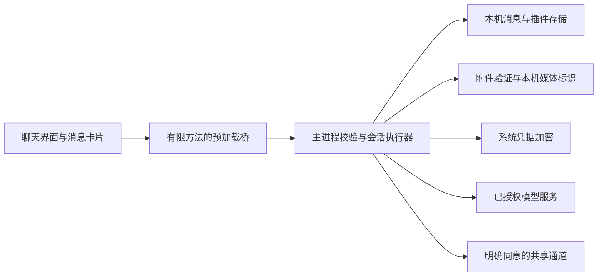

# 本机 QQ 静态分析与哦鲸鲸工程借鉴

核验日期：2026-11-05。范围仅限本机已安装的 QQ 程序资源。本报告区分文件事实、工程推断与未验证事项；未把静态字符串当成实际运行证据。

## 方法与访问边界

使用已安装的 `@electron/asar 4.3.1` 列出容器目录，并读取 ASAR 头部与少量代表文件的元数据/字节；对 9 个原生程序模块做 SHA-256 与有限符号白名单匹配。ASAR 部分目录键名带斜杠，通用 stat 接口不能逐项解析；因此仅对已验证 offset/size 的条目作只读范围读取，没有执行加载器或解密代码。

没有安装或运行 REA，没有改全局 MCP，没有启动 QQ、注入、patch、hook、网络抓包或向 QQ 服务器发出请求；没有执行 QQ 安装包中的 JavaScript、原生模块、CLI 或未知 bundle。没有读取用户 profile、聊天数据库、缓存、Cookie、LocalStorage、账号配置、凭据或日志。顶层发现程序目录与用户资料混放后，后续读取只限定在两个 `versions` 程序资源目录，未进入用户资料目录。

没有复制整个 ASAR 或安装库；代表资源只在内存中检查。交付证据只保留程序路径、版本、大小、哈希、类型/目录统计与有限非秘密符号，不包含 QQ 受版权保护的代码片段或用户内容。

## 直接看到的文件事实

- 启动器 `<QQ 安装目录>/QQ.exe`：文件版本 `9.9.33.52230`，产品版本 `9.9.33.52230-aff854e8`，1,717,800 bytes；SHA-256：`abbed71fc3dfe84fa712a2243041029c4a2e60b25595528522cb92c5758d388a`。
- `versions` 同时存在 9.9.33-52230 与 9.9.36-53644 完整安装资源，以及差分更新目录。两个完整版本的 `resources/app/package.json` 分别声明对应版本、`main: ./application.asar/app_launcher/index.js`、`platform: win32`、`eleArch: x64`、`isPureShell: true`、`isByteCodeShell: true`。没有启动 QQ，因此不能确认当前实际运行版本已切到较新资源。
- 两版 `application.json` 的顶层键对应 `application.asar`、`wrapper.node`、`major.node`、`package.json` 等程序文件；未把其中的完整性元数据值复制进证据。QQNT.dll 的 Windows 文件版本字段为空，不能凭此补写 Electron/Chromium 版本。

| 安装资源版本 | application.asar bytes | 条目数（含目录） | 文件数 | .js / .html | preload 文件 |
|---|---:|---:|---:|---:|---:|
| 9.9.33-52230 | 30,339,880 | 1446 | 1423 | 173 / 11 | 13 |
| 9.9.36-53644 | 30,889,616 | 1475 | 1452 | 175 / 11 | 13 |

每版抽查 13 个代表条目，共 26 个。`app_launcher/index.js`、`launcher.js`、`background.js` 的样本只有 80 bytes，`preload.js` 240 bytes、`preload_chatwin.js` 256 bytes。`.html` 与其他前端 bundle 样本同样不是可直接阅读的明文 HTML/JS；约 29%–38% 的前 4 KiB 字节属于可打印 ASCII，未看到 `<html` 标签或白名单接口名。结合 manifest 的 bytecode-shell 标记，可以确认不能把扩展名等同于可读源代码；具体编码、加密或加载方式未逆向验证。

## 可见模块及可能的职责

| 看到的文件/符号 | 已见事实 | 合理推断与边界 |
|---|---|---|
| `background.js`、分块 background、`app_launcher/` | 容器内存在启动与后台资源名。 | 可能分别承担启动、主流程和按需服务；未还原真实调用图。 |
| `preload_chatwin.js`、`preload_login.js`、`preload_qzone_view.js`、浏览器/webview 类 preload | 两版均有 13 个用途分开的 preload 资源名。 | 说明其打包结构区分聊天、登录、空间、内嵌浏览等表面；不证明每个边界的权限配置正确。 |
| `AgentChat-*`、`AgentMessage-*`、`ChatReasoning-*`、`message-*`、`MediaItem-*`、`feed-post-*`、`comment-list-*`、`debounceDedup-*` | guild 前端资源内存在这些独立 bundle 名。 | 可借鉴将消息、媒体、思考状态、动态/评论、去重拆开；不证明功能已开启或公开可调用。 |
| `major.node` | 命中 `contextBridge`、`exposeInMainWorld`、`ipcRenderer`、`ipcMain`、`nodeIntegration`、`contextIsolation` 等长标识。 | 存在桥接/权限相关程序字符串；不能由字符串判断选项值、执行路径或安全性。 |
| `major.node`、`wrapper.node` | 命中 `KernelMsgService`、`sendMsg`、`getMsgs`、`onRecvMsg`、`recallMsg`。 | 与消息内核/会话服务边界一致，但不是可供哦鲸鲸调用的公开 SDK；本次没有调用这些接口。 |
| `ipc.node`、`initIpc_x64.node`、`broadcast_ipc.dll` | 本机存在这些原生模块；initIpc 样本命中 `sendMsg`。 | 可能承载进程间通信；未验证协议、鉴权、消息 schema 或接收端身份。 |
| `AudioFoundation.node`、`ThumbPlayer.dll`、`TPDataTransport.dll`、FFmpeg 相关库、截图目录 | 文件名与程序模块确实存在。 | 与录音/播放/媒体传输/截图职责吻合；未测试设备、编码格式、服务端能力。 |
| `libcurl.dll`、`ssl.dll`、`crypto.dll`、`LightQuic.dll` | 安装资源存在网络与密码库；部分命中 `SSL_connect`、`SSL_CTX_set_verify`、`X509_verify_cert`、`EVP_EncryptInit_ex`、`X25519` 等长符号。 | 库具备相应实现/引用线索；不证明每条请求使用 TLS、检查证书，也不能推出实际协议、密钥策略或端到端加密。 |
| `wrapper.node` | 命中 `CryptProtectData`、`CryptUnprotectData`、`sqlite3_open`、`sqlite3_key`。 | 有 Windows 数据保护和数据库加密接口线索；未读取数据库，不能断言聊天、附件、所有索引或密钥实际如何存放。 |
| `resource/default-emojis`、`chuo-lottie`、`fonts`、`icons`、`miniapp`、`qqb` | 公共程序资源目录存在。 | 可借鉴独立资源目录和可选功能边界；本次没有复制 QQ 图片、表情、动画或代码到哦鲸鲸。 |

符号命中只是静态字节出现。证据另列 `strongSymbols` 区分较长的明确标识；短的 AES/TLS/RSA 字节可能偶然出现，更不能独立用作安全结论。

## 不应声称已经查明的事项

- 没有得到 QQ 的完整明文源码、真实运行调用图、对外稳定 API 或服务器实现。
- 没有核验 QQ 消息传输的具体加密套件、证书验证策略、会话密钥轮换、服务端可见范围、群聊密钥分发或端到端加密。发现密码库、DPAPI/SQLite 相关符号，不等于证明上述任一机制已正确用于用户消息。
- 未扫描 QQ 用户数据库，不能据安装资源判断用户聊天本地是否全部加密、是否可恢复、如何清理、是否同步。
- 未运行 QQ，不能确认资源名所暗示的空间、代理聊天、撤回或媒体功能在当前账户/当前版本中可用。
- REA 没有参与；不把 ASAR 列表与有限字符串匹配描述成动态逆向、渗透测试或完成的安全审计。

## 哦鲸鲸应借鉴的独立工程结构

可借鉴的是边界与数据流组织，使用本项目自己的实现，不调用 QQ 私有接口，不复用其代码、协议、凭据或用户数据。建议保持以下关系：

| 项目机制 | 当前本机源码检查结果 | 应维持/下一步 |
|---|---|---|
| 消息事件与状态 | 本项目已有稳定 id、来源/角色、pending/sent/failed/cancelled、增量 delta 与 state 刷新；重试复用用户消息。 | 持续用 schema 校验和去重，不能把本机发送完成当远端已读；未来回执需分开标识。 |
| 渲染与 IPC | `main.cjs` 校验 webContents 与精确 sender frame URL；窗口启用 contextIsolation/sandbox、关闭 nodeIntegration，阻止新窗口与意外导航；preload 暴露方法白名单；页面有 CSP。 | 保持每个 IPC 方法独立校验输入；模型、P2P 或文案不能提供任意方法名/文件路径/代码执行。新增窗口时重新核验来源边界。 |
| 密钥 | 主进程使用 safeStorage，系统加密不可用时报错；公开状态不带 key；更改服务地址清除旧 key。 | 不把 key 放 renderer、日志、角色卡或共享接口；网络请求继续限制 HTTPS/loopback，并防止重定向携带凭据。 |
| 媒体 | 附件通过本机媒体 id 与专用 scheme，模型图片由主进程解析为 data URL。 | 继续检查大小、真实格式、引用范围和授权；远端附件不能触发任意 URL 下载、文件路径读取或 HTML/SVG 执行。 |
| 私有记忆/共享 | 本项目共享回复不带主人的历史和私有记忆 hook；记忆需显式保存，角色卡导出排除插件记忆。 | 继续保持默认不外发；私人聊天与外部共享使用不同上下文构造器，并维持共享 opt-in、撤销、额度和并发约束。 |
| 日志 | 设计为模型/状态/耗时/token 元数据，不写提示词、图片和 key。 | 若以后接入更多插件，应将异常 code 也限制为固定枚举，防止任意错误对象的自定义字段进入日志。 |
| 本机数据保护 | 目前只有 API key 加密；聊天、显式记忆、日记、空间 JSON 与附件是本机明文。 | 界面说明应准确。若用户要求更强的静态保密，需另做数据库/附件加密、密钥生命周期、导出与恢复方案，不能声称已具备。 |
| 快照/停用 | 当前 append-only 快照与 SHA-256 可检测意外损坏并回退；停用记忆仅改变 active，不再用于上下文。 | SHA-256 不是抗同账户篡改的签名；旧快照仍保留文本。UI 应说“停用/不再用于对话”，不能宣称已从磁盘彻底删除。 |

当前这轮定向源码检查未发现需要因 QQ 分析结论而立即扩大权限或调用 QQ 私有接口的理由，也未发现必须中断现有打包流程才能修复的重大问题。以上是有限静态核对，不能替代完整运行测试、威胁建模或安全审计。

## 可复核证据

- 机器可读证据：`artifacts/qq-analysis/evidence.json`。含两个本机程序版本的清单、ASAR SHA-256/条目统计、26 个代表条目的 hash/可打印比例、9 个原生样本的 hash 与有限标识、读取范围/未验证边界。
- 本报告不附 QQ 代码段，也没有将源码或数据库传给外部模型。分析时的网络操作仅属于此前明确授权的公开表情素材检索与下载；QQ 静态分析本身没有网络通信。
